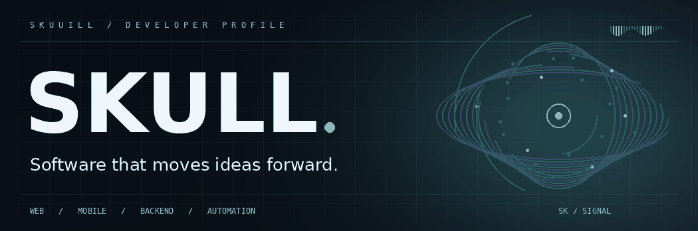
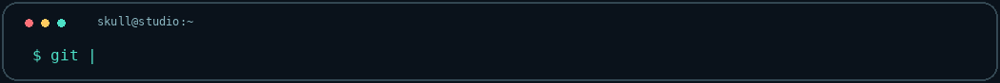
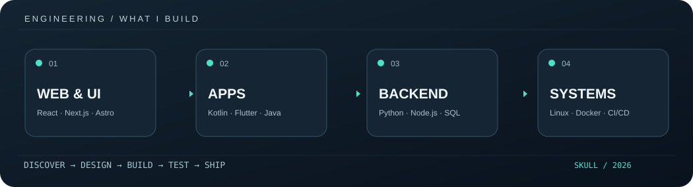

  <a href="https://skuuill.github.io/SkuuIll_Folio/" title="Abrir el portafolio de Skull">
    <picture>
      <source media="(prefers-reduced-motion: reduce)" srcset="./assets/hero-static-v2.svg">
      
    </picture>
  </a>

<h1 align="center">Hola, soy Skull.</h1>

  <strong>Desarrollador de software Full Stack y multiplataforma.</strong> 
  Desde Charata, Chaco, Argentina. Desarrollo productos web, Android y sistemas que resuelven problemas reales.

  <a href="https://skuuill.github.io/SkuuIll_Folio/"><strong>Portafolio y casos de estudio ↗</strong></a>
  &nbsp; · &nbsp;
  <a href="https://github.com/SkuuIll?tab=repositories">Repositorios</a>
  &nbsp; · &nbsp;
  <a href="mailto:moreappmix@gmail.com">Trabajemos juntos</a>

  

## 01 / Sobre mí

No me limito a construir pantallas: trabajo sobre el **producto completo**, desde el diseño de la experiencia hasta APIs, bases de datos, aplicaciones y despliegues en Linux.

Soy desarrollador independiente. Me interesan la **automatización**, las interfaces cuidadas, los sistemas mantenibles y la integración entre tecnologías. En este perfil muestro una selección de proyectos propios, trabajos privados documentados mediante casos y herramientas de código abierto.

**Mi enfoque:** entender el problema → diseñar → desarrollar → probar → publicar → mejorar.

## 02 / Proyectos que construí

<table>
<tr>
<td width="50%" valign="top">
  
  <h3>Vigía · Ecosistema hotelero</h3>
  
Gestión de seguridad y rondas GPS, personal, operaciones hoteleras y administración. Panel web, API y aplicación Android conectados.

  
<code>React</code> <code>NestJS</code> <code>PostgreSQL</code> <code>Expo</code>

  <a href="https://skuuill.github.io/SkuuIll_Folio/proyectos/vigia/">Explorar el caso →</a>
</td>
<td width="50%" valign="top">
  
  <h3>Atelier · Indumentaria 3D</h3>
  
Configurador interactivo de prendas integrado a un flujo de catálogo, personalización y ventas.

  
<code>Next.js</code> <code>TypeScript</code> <code>Three.js</code> <code>Prisma</code>

  <a href="https://skuuill.github.io/SkuuIll_Folio/proyectos/cpaul/">Ver la experiencia →</a>
</td>
</tr>
<tr>
<td width="50%" valign="top">
  
  <h3>Tactical Map · Cartografía PWA</h3>
  
Mapas, medidas, marcadores y herramientas de planificación para PUBG, accesibles desde el navegador.

  
<code>JavaScript</code> <code>Leaflet</code> <code>PWA</code>

  <a href="https://skuuill.github.io/PUBG-Mortar-Tactical-Map/">Abrir la aplicación →</a>
</td>
<td width="50%" valign="top">
  
  <h3>FluxNet · Android y redes</h3>
  
Proyecto en desarrollo con cliente Android, API, administración y nodos VPS para una plataforma VPN.

  
<code>Kotlin</code> <code>Flutter</code> <code>Go</code> <code>Linux</code>

  <a href="https://skuuill.github.io/SkuuIll_Folio/proyectos/fluxnet/">Conocer el proyecto →</a>
</td>
</tr>
</table>

**También desarrollé:**
[Repo Setup Kit](https://github.com/SkuuIll/Repo-Setup-Kit), un entorno reproducible para desarrollo con agentes y automatización;
[Mi Taller](https://skuuill.github.io/SkuuIll_Folio/proyectos/mi-taller/), gestión de presupuestos y producción textil;
[Catálogo comercial](https://skuuill.github.io/SkuuIll_Folio/proyectos/showroom/), productos y ventas;
y [otros proyectos de software](https://skuuill.github.io/SkuuIll_Folio/proyectos/).

Las capturas proceden de los casos publicados en el repositorio del portafolio. Los proyectos con código privado se muestran mediante descripciones y demostraciones; no se presentan como código público.

## 03 / Del frontend a la infraestructura

  

| Especialidad | Tecnologías y herramientas |
| :--- | :--- |
| **Web y experiencia** | React, Vue, Next.js, Astro, HTML, CSS, JavaScript, TypeScript, UI/UX |
| **Backend y bases de datos** | Python, Django, Node.js, NestJS, PostgreSQL, MySQL, SQLite, Prisma, Redis |
| **Mobile y escritorio** | Kotlin, Java, Flutter, React Native, .NET, herramientas Windows |
| **Servidores y DevOps** | Linux, VPS, Docker, Git, GitHub Actions, Shell, PowerShell, CI/CD |
| **Diseño técnico y automatización** | Three.js, GSAP, Canvas, Python, scripts, integraciones y agentes de IA |

No se trata de una lista de tecnologías aisladas: me interesa **conectarlas en productos funcionales**, con código que pueda mantenerse y evolucionar.

## 04 / Código y actividad

  <a href="https://github.com/SkuuIll?tab=repositories">Explorar todos mis repositorios ↗</a>
  &nbsp; · &nbsp;
  <a href="https://github.com/SkuuIll/Repo-Setup-Kit">Herramientas de automatización ↗</a>

<strong>Ver métricas de GitHub y lenguajes</strong>

Las métricas se actualizan mediante GitHub Actions y reflejan datos públicos de los repositorios, no la totalidad del trabajo profesional.

  
  

## 05 / ¿Hacemos algo juntos?

Desarrollo sistemas de gestión, aplicaciones, herramientas de productividad, interfaces y automatizaciones. Si tenés un producto para construir o un proceso para mejorar, podemos conversar sobre el problema, la tecnología y el alcance.

  <a href="mailto:moreappmix@gmail.com"><strong>Enviar un correo ↗</strong></a>
  &nbsp; · &nbsp;
  <a href="https://skuuill.github.io/SkuuIll_Folio/"><strong>Ver mi portafolio ↗</strong></a>
  &nbsp; · &nbsp;
  <a href="https://github.com/SkuuIll"><strong>GitHub ↗</strong></a>

---

  SKULL / SkuuIll · Perfil de GitHub independiente · El sitio web y sus componentes viven en <a href="https://github.com/SkuuIll/SkuuIll_Folio">SkuuIll_Folio</a>.

