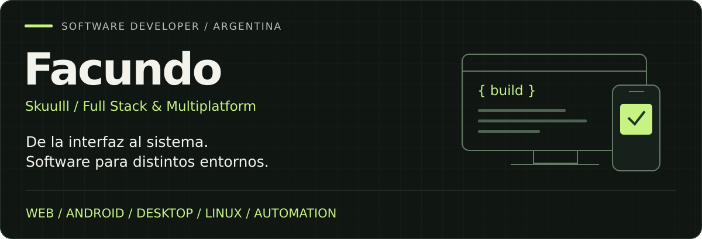

# Facundo · SkuuIll

Desarrollador de software · Full Stack & Multiplataforma · Argentina

Aplicaciones web, Android y escritorio. Backend, integraciones y entornos Linux.

[Conversemos sobre tu proyecto](mailto:moreappmix@gmail.com) · [Explorá mi código](https://github.com/SkuuIll?tab=repositories) · [English](./translations/README.en.md)

---

## Software pensado para el contexto en el que se usa

Soy Facundo, desarrollador de software de Argentina. Trabajo en distintas capas de un producto: la interfaz que usa una persona, la lógica que procesa sus datos y el entorno donde se ejecuta. Mi trabajo abarca **web, aplicaciones Android, herramientas de escritorio, automatización y servidores Linux**.

Uso **Java, Kotlin, Dart, JavaScript, TypeScript, Python, Go, C# y C++**, según las necesidades del proyecto. Me interesa conectar esas tecnologías para construir soluciones completas: una app con su API, un comercio con su administración, una herramienta de escritorio con integración al sistema o un flujo de trabajo que reduzca tareas repetitivas.

En este perfil reúno proyectos públicos, trabajo con código privado y adaptaciones de software abierto. Cada uno muestra una parte distinta de lo que hago.

  <a href="#especialidades">Especialidades</a> ·
  <a href="#tecnologías">Tecnologías</a> ·
  <a href="#proyectos-públicos">Proyectos</a> ·
  <a href="#productos-con-código-privado">Otros productos</a> ·
  <a href="#contacto">Contacto</a>

## Especialidades

| Área | Qué desarrollo | Qué incluye |
| :--- | :--- | :--- |
| **01 · Web & Full Stack** | Aplicaciones web, tiendas, catálogos, landings y paneles de gestión. | Interfaz, lógica de negocio, autenticación, datos e integraciones. |
| **02 · Android & Mobile** | Aplicaciones Android y soluciones móviles con Flutter. | Navegación, archivos, multimedia, permisos y conexión con servicios. |
| **03 · Escritorio & Sistema** | Herramientas para Windows y utilidades integradas con el sistema. | Interfaces de escritorio, procesamiento de audio y automatización local. |
| **04 · Backend & APIs** | Servicios que conectan aplicaciones, usuarios y procesos. | APIs, bases de datos, administración y comunicación entre componentes. |
| **05 · Linux & Infraestructura** | Preparación y operación de entornos de desarrollo y servidores. | Trabajo en distintas distribuciones Linux, VPS, terminal, servicios y contenedores. |
| **06 · Automatización & IA** | Scripts, bots y herramientas para desarrollo y producción de contenido. | Configuración de proyectos, integración de modelos y flujos de trabajo asistidos. |

## Tecnologías

Mi trabajo no está limitado a un único lenguaje o sistema operativo. Elijo las herramientas según la plataforma, las integraciones necesarias y el mantenimiento que va a requerir el producto.

| Ecosistema | Lenguajes y herramientas |
| :--- | :--- |
| **Lenguajes** | Java · Kotlin · Dart · JavaScript · TypeScript · Python · Go · C# · C++ |
| **Web e interfaces** | React · Next.js · HTML · CSS · Leaflet |
| **Backend** | Node.js · Django · Go · APIs e integraciones |
| **Android** | Flutter · Dart · Kotlin · Java |
| **Escritorio** | .NET · WPF · C# · C++ |
| **Datos y persistencia** | SQL · SQLite · Prisma · Redis |
| **Sistemas y entrega** | Linux · Windows · Android · Git · GitHub Actions · Docker · VPS |
| **Automatización y contenido** | Python · Shell · PowerShell · Batch · Telegram · Remotion · integración de IA |

Los proyectos de abajo muestran cómo se combinan estas tecnologías. Las estadísticas de GitHub reflejan código alojado en repositorios; no representan por sí solas toda mi experiencia.

## Proyectos públicos

### 01 / Repo Setup Kit

Automatización del entorno de desarrollo · Windows + Linux

Preparar un repositorio implica repetir configuración, documentación y comprobaciones. Repo Setup Kit reúne ese arranque en una herramienta de línea de comandos para trabajar con Codex y agentes de IA.

- Instaladores para Windows y Linux y comandos de preparación, diagnóstico y previsualización.
- Generación de contexto del proyecto, instrucciones para agentes y plantillas de trabajo.
- Integraciones con RTK, GitNexus y Engram, además de configuración inicial de hooks y CI cuando corresponde.
- Respeto por configuraciones existentes y avisos cuando la preparación queda parcial.

**Tecnologías:** Python · PowerShell · Shell · Git · GitHub Actions.

[Ver código e instalación →](https://github.com/SkuuIll/Repo-Setup-Kit)

### 02 / PUBG Mortar Tactical Map

Aplicación web interactiva · Mapas + PWA

Una herramienta para jugadores de PUBG que reúne medición de distancias, cálculo de morteros dentro del juego y planificación sobre mapas interactivos.

- Mapas con herramientas de dibujo y medición.
- Configuraciones compartibles mediante URL y exportación de la vista como imagen.
- Instalación como PWA, tema claro/oscuro y atajos de teclado.
- Organización modular en JavaScript, con servicios separados para compartir, exportar y gestionar el tema.

**Tecnologías:** JavaScript · HTML · CSS · Leaflet · Service Worker.

[Explorar la aplicación →](https://skuuill.github.io/PUBG-Mortar-Tactical-Map/) · [Ver código →](https://github.com/SkuuIll/PUBG-Mortar-Tactical-Map)

### 03 / Blog · Informatorio Chaco

Aplicación de contenido · Backend + Administración + IA

Proyecto final del programa Informatorio Chaco 2025: un blog con gestión de publicaciones, usuarios e integración con Gemini para asistir la creación de contenido.

- CRUD de publicaciones y organización de contenido.
- Autenticación, autorización y administración con Django.
- Herramientas de generación de contenido e imágenes integradas al flujo editorial.
- Interfaz con templates y recursos de frontend.

**Tecnologías:** Python · Django · HTML · Tailwind CSS · Alpine.js · Gemini.

[Explorar el repositorio →](https://github.com/SkuuIll/Project-Final-Informatorio-25)

### Más proyectos y herramientas

| Proyecto | Enfoque | Qué podés explorar |
| :--- | :--- | :--- |
| [**Pipa_arg**](https://github.com/SkuuIll/Pipa_arg) | Web e identidad de comunidad | Landing para PIPAA y Panza Army, desarrollada en TypeScript. |
| [**WebBanderasPUBG**](https://github.com/SkuuIll/WebBanderasPUBG) | Herramienta web | Utilidad de banderas para PUBG desarrollada en JavaScript. |
| [**Djangoautomatic**](https://github.com/SkuuIll/Djangoautomatic) | Automatización con Python | Creación de proyectos Django, entorno virtual, estructura de carpetas y configuración por entorno. |
| [**ScriptOptimize**](https://github.com/SkuuIll/ScriptOptimize) | Scripting en Windows | Script Batch con tareas de optimización del sistema. |
| [**NFile-es**](https://github.com/SkuuIll/NFile-es) | Android y código abierto | Fork de [Senzme/NFile](https://github.com/Senzme/NFile): gestor de archivos y multimedia con Flutter/Dart. |

**Sobre NFile-es:** el proyecto base pertenece a Senzme/NFile. Lo presento como un repositorio derivado, con atribución a su autor original y sujeto a su licencia GPL v3.

[Ver todos mis repositorios públicos →](https://github.com/SkuuIll?tab=repositories&type=public)

## Productos con código privado

Parte de mi trabajo está en repositorios privados. Estas son las descripciones que comparto públicamente; el código fuente no está disponible en este perfil.

### Android, servicios y escritorio

| Producto | Funcionalidad | Tecnologías |
| :--- | :--- | :--- |
| **FluxNet** | Plataforma VPN para Android con API, panel de administración y gestión de nodos. | Flutter · Kotlin · Go · React |
| **BattleFX** | Centro de control para gaming en Windows, con procesamiento de audio y un efecto de sistema propio. | C# · .NET · WPF · C++ |
| **BotCheck** | Bot de Telegram con panel administrativo, monitoreo de servicios, diagnóstico y gestión de logs. | Node.js · Telegram · Redis |

### Comercio y producción de contenido

| Producto | Funcionalidad | Tecnologías |
| :--- | :--- | :--- |
| **CPaul** | Tienda de indumentaria personalizada con Atelier 3D, catálogo, pedidos y checkout. | Next.js · React · TypeScript · Prisma |
| **Web-Catalogo** | Catálogo comercial con filtros, administración de productos y consultas por WhatsApp. | Next.js · TypeScript · Prisma · SQLite |
| **VidAutonomo** | Generación de videos verticales con flujo de guion, voz, subtítulos y render desde un panel web. | Remotion · Node.js |

[Consultame por estos proyectos →](mailto:moreappmix@gmail.com?subject=Consulta%20sobre%20proyectos)

## Cómo podemos trabajar

Puedo participar en un producto nuevo o en una base de código existente. El alcance puede incluir una aplicación completa, un módulo, una integración o la mejora de una herramienta que ya está en uso.

| Etapa | Qué definimos o revisamos |
| :--- | :--- |
| **01 · Entender** | El problema, quién usa el sistema, la plataforma y las restricciones actuales. |
| **02 · Delimitar** | Funcionalidades, prioridades, entregables, presupuesto y plazos acordados. |
| **03 · Construir** | Implementación por partes que puedan revisarse y ajustes sobre lo construido. |
| **04 · Validar** | Comportamiento esperado, integraciones y funcionamiento en los entornos acordados. |
| **05 · Entregar** | Código, instrucciones y despliegue o instalación, según el alcance del proyecto. |

El mantenimiento y las mejoras posteriores se acuerdan según las necesidades de cada trabajo.

## Contacto

**¿Tenés una idea, una aplicación por mejorar o un proceso para automatizar?**

Contame qué necesitás, en qué plataforma debe funcionar —web, Android, Windows o Linux— y qué existe actualmente. Si tenés referencias, funcionalidades prioritarias o una fecha objetivo, también ayudan a definir una propuesta.

**[moreappmix@gmail.com](mailto:moreappmix@gmail.com)** · [GitHub / SkuuIll](https://github.com/SkuuIll)

---

## Actividad y código abierto

Ver actividad de GitHub y lenguajes en los repositorios

Estas imágenes se actualizan mediante GitHub Actions y reflejan su última ejecución.

Ver animación de contribuciones

<picture>
  <source media="(prefers-color-scheme: dark)" srcset="https://raw.githubusercontent.com/SkuuIll/SkuuIll/output/github-snake-dark.svg">
  
</picture>

Sobre este perfil y la web en preparación

Este repositorio contiene el perfil de GitHub, sus recursos visuales y el código de una web de servicios en preparación.

- [Código de la web](./site/).
- [Guía de vista previa y configuración](./docs/landing.md).
- [Versión en inglés del perfil](./translations/README.en.md).
- Las demás traducciones se conservan como versiones anteriores y pueden estar desactualizadas.

Facundo · SkuuIll — Software, sistemas y herramientas desde Argentina. 🧉

