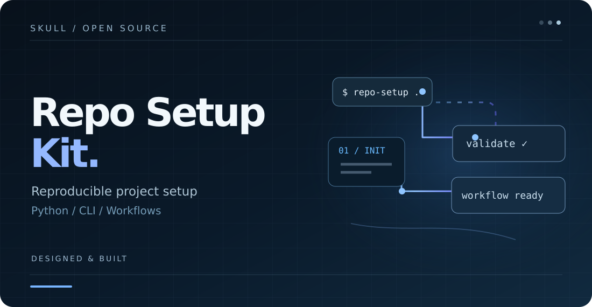
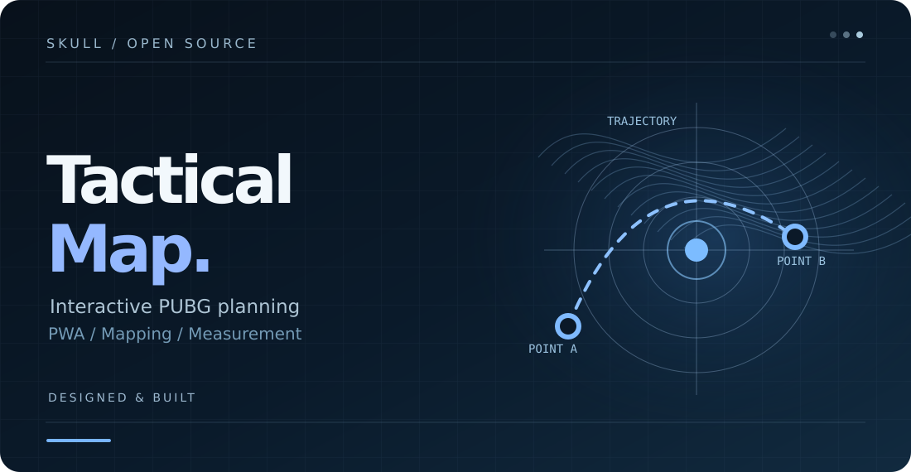

  <a href="https://github.com/SkuuIll" title="Skull on GitHub">
    <picture>
      <source media="(prefers-reduced-motion: reduce)" srcset="./assets/hero-static-v2.svg">
      
    </picture>
  </a>

<h1 align="center">Skull · Full Stack Developer</h1>

  Building thoughtful software, from interface to infrastructure. 
  Web · Android · Backend · Automation

  
  &nbsp;
  

  <a href="https://skuuill.github.io/SkuuIll_Folio/">Portfolio ↗</a>
  &nbsp;·&nbsp;
  <a href="https://github.com/SkuuIll?tab=repositories">Repositories ↗</a>
  &nbsp;·&nbsp;
  <a href="mailto:moreappmix@gmail.com">Contact ↗</a>

---

## English

### A little about me

I'm an independent software developer based in Chaco, Argentina. I build web and Android applications, APIs, business tools and automation systems. I care about **useful products, maintainable code and well-designed interfaces**.

  

### Selected public projects

<table>
  <tr>
    <td width="50%" valign="top">
      
      <h3>Repo Setup Kit</h3>
      
A reproducible setup toolkit for Git repositories, AI coding tools and development workflows.

      
<code>Python</code> <code>CLI</code> <code>Automation</code>

      
<a href="https://github.com/SkuuIll/Repo-Setup-Kit">Explore repository ↗</a>

    </td>
    <td width="50%" valign="top">
      
      <h3>Tactical Map</h3>
      
A PUBG planning and measurement tool with interactive maps and installable PWA support.

      
<code>JavaScript</code> <code>Leaflet</code> <code>PWA</code>

      
<a href="https://github.com/SkuuIll/PUBG-Mortar-Tactical-Map">Source ↗</a> · <a href="https://skuuill.github.io/PUBG-Mortar-Tactical-Map/">Live application ↗</a>

    </td>
  </tr>
</table>

**More open work:** [PIPAA](https://github.com/SkuuIll/Pipa_arg) — a responsive community landing page with a dedicated commands section.

Artwork is original and illustrative; it is not an application screenshot.

### Private projects

Private implementations are presented in text only.

| Project | What it does |
| :--- | :--- |
| **Vigía · Hotel operations** | Connects hotel management, staff workflows and GPS-based security rounds. |
| **Atelier · Apparel 3D** | Lets customers preview and personalize clothing in an interactive interface. |
| **Textile workshop management** | Organizes quotations, clients and clothing production workflows. |
| **Commercial product catalog** | Presents products, variants and sales enquiries through a focused catalog. |
| **FluxNet · Network platform** | An in-development project combining a mobile client, API and VPS infrastructure. |

### What I work with

| Discipline | Tools and technologies |
| :--- | :--- |
| **Web & interfaces** | React, Next.js, Vue, Astro, TypeScript, HTML, CSS |
| **Backend & data** | Python, Node.js, Java, PostgreSQL, MySQL, SQLite, Redis |
| **Mobile & systems** | Kotlin, Flutter, Android, Linux |
| **Delivery & automation** | Docker, GitHub Actions, CI/CD, Shell, Python |

### Let's connect

I work on custom applications, interfaces and automation for practical problems.

**[View the portfolio](https://skuuill.github.io/SkuuIll_Folio/)** · **[Email me](mailto:moreappmix@gmail.com)** · **[Explore GitHub](https://github.com/SkuuIll?tab=repositories)**

<a href="#espanol">Leer en español ↓</a>

---

## Español

### Sobre mí

Soy desarrollador de software independiente de Chaco, Argentina. Creo aplicaciones web y Android, APIs, herramientas de gestión y sistemas de automatización. Me enfoco en **productos útiles, código mantenible e interfaces bien diseñadas**.

### Proyectos públicos destacados

<table>
  <tr>
    <td width="50%" valign="top">
      
      <h3>Repo Setup Kit</h3>
      
Kit reproducible para preparar repositorios Git e integrar herramientas de desarrollo asistido por IA.

      
<code>Python</code> <code>CLI</code> <code>Automatización</code>

      
<a href="https://github.com/SkuuIll/Repo-Setup-Kit">Ver repositorio ↗</a>

    </td>
    <td width="50%" valign="top">
      
      <h3>Tactical Map</h3>
      
Herramienta de planificación y medición para PUBG, con mapas interactivos y soporte PWA.

      
<code>JavaScript</code> <code>Leaflet</code> <code>PWA</code>

      
<a href="https://github.com/SkuuIll/PUBG-Mortar-Tactical-Map">Código ↗</a> · <a href="https://skuuill.github.io/PUBG-Mortar-Tactical-Map/">Abrir aplicación ↗</a>

    </td>
  </tr>
</table>

**Otro proyecto público:** [PIPAA](https://github.com/SkuuIll/Pipa_arg) — página de presentación de una comunidad, adaptable a dispositivos móviles y con sección de comandos.

Las ilustraciones son diseños originales conceptuales, no capturas de las aplicaciones.

### Proyectos privados

Estos proyectos se presentan solamente con texto.

| Proyecto | Qué hace |
| :--- | :--- |
| **Vigía · Gestión hotelera** | Integra operaciones del hotel, control de personal y rondas de seguridad mediante GPS. |
| **Atelier · Indumentaria 3D** | Permite visualizar y personalizar prendas en una interfaz interactiva. |
| **Gestión de taller textil** | Organiza presupuestos, clientes y procesos de producción de indumentaria. |
| **Catálogo comercial** | Presenta productos, variantes y consultas de venta en un catálogo digital. |
| **FluxNet · Plataforma de redes** | Proyecto en desarrollo que integra una app móvil, API e infraestructura VPS. |

### Tecnologías

| Área | Tecnologías y herramientas |
| :--- | :--- |
| **Web e interfaces** | React, Next.js, Vue, Astro, TypeScript, HTML, CSS |
| **Backend y datos** | Python, Node.js, Java, PostgreSQL, MySQL, SQLite, Redis |
| **Android y sistemas** | Kotlin, Flutter, Android, Linux |
| **Despliegue y automatización** | Docker, GitHub Actions, CI/CD, Shell, Python |

### Contacto

Desarrollo aplicaciones a medida, interfaces y automatizaciones para resolver necesidades reales.

**[Ver portafolio](https://skuuill.github.io/SkuuIll_Folio/)** · **[Enviar correo](mailto:moreappmix@gmail.com)** · **[Explorar GitHub](https://github.com/SkuuIll?tab=repositories)**

<a href="#english">↑ Back to English</a>

---

  
<strong>GitHub activity / Actividad y métricas</strong>

  
Public repository metrics only / Métricas de repositorios públicos solamente.

  

    
    
  

  SKULL · GitHub profile only / Perfil de GitHub. 
  The interactive website lives separately at <a href="https://github.com/SkuuIll/SkuuIll_Folio">SkuuIll_Folio</a>.

