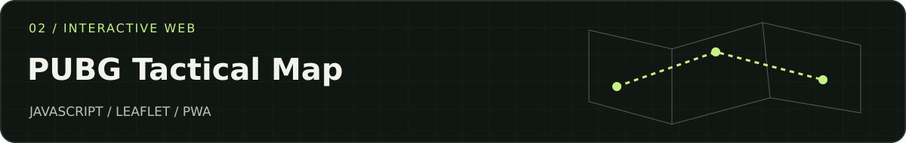
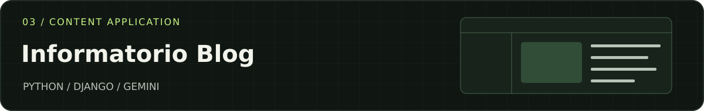

# Facundo · SkuuIll

**Software Developer · Full Stack & Cross-Platform · Argentina**

Web, Android and desktop applications. Backends, integrations and Linux environments.

[Let's discuss your project](mailto:moreappmix@gmail.com) · [Explore my code](https://github.com/SkuuIll?tab=repositories) · [Español](../README.md)

---

### Software built for the context in which it is used

I'm Facundo, a software developer from Argentina. I work across the layers of a product: the interface people use, the logic that processes their data and the environment where it runs. My work spans **web, Android applications, desktop tools, automation and Linux servers**.

I use **Java, Kotlin, Dart, JavaScript, TypeScript, Python, Go, C# and C++**, depending on the project. I enjoy connecting these technologies into complete solutions: an app with its API, a store with its administration tools, a desktop utility with system integration or a workflow that reduces repetitive tasks.

This profile brings together public projects, work with private source code and adaptations of open source software. Each shows a different part of my work.

  <a href="#specialties">Specialties</a> ·
  <a href="#technologies">Technologies</a> ·
  <a href="#public-projects">Projects</a> ·
  <a href="#products-with-private-source-code">Other products</a> ·
  <a href="#contact">Contact</a>

## Specialties

| Area | What I build | What it includes |
| :--- | :--- | :--- |
| **01 · Web & Full Stack** | Web applications, stores, catalogs, landing pages and management dashboards. | Interfaces, business logic, authentication, data and integrations. |
| **02 · Android & Mobile** | Android applications and mobile solutions with Flutter. | Navigation, files, media, permissions and service connections. |
| **03 · Desktop & System** | Windows tools and utilities integrated with the operating system. | Desktop interfaces, audio processing and local automation. |
| **04 · Backends & APIs** | Services connecting applications, users and processes. | APIs, databases, administration and communication between components. |
| **05 · Linux & Infrastructure** | Development environments and server setup and operation. | Different Linux distributions, VPS, terminal tools, services and containers. |
| **06 · Automation & AI** | Scripts, bots and tools for development and content production. | Project setup, model integration and assisted workflows. |

## Technologies

My work is not limited to a single language or operating system. I choose tools according to the platform, required integrations and the product's maintenance needs.

| Ecosystem | Languages and tools |
| :--- | :--- |
| **Languages** | Java · Kotlin · Dart · JavaScript · TypeScript · Python · Go · C# · C++ |
| **Web and interfaces** | React · Next.js · HTML · CSS · Leaflet |
| **Backends** | Node.js · Django · Go · APIs and integrations |
| **Android** | Flutter · Dart · Kotlin · Java |
| **Desktop** | .NET · WPF · C# · C++ |
| **Data and persistence** | SQL · SQLite · Prisma · Redis |
| **Systems and delivery** | Linux · Windows · Android · Git · GitHub Actions · Docker · VPS |
| **Automation and content** | Python · Shell · PowerShell · Batch · Telegram · Remotion · AI integration |

The projects below show how these technologies fit together. GitHub statistics describe code hosted in repositories; they do not represent my entire experience on their own.

## Public projects

### 01 / Repo Setup Kit

**Development environment automation · Windows + Linux**

Setting up repositories involves repeated configuration, documentation and checks. Repo Setup Kit brings that preparation into a command-line tool for working with Codex and AI agents.

- Windows and Linux installers, with setup, diagnostic and dry-run commands.
- Project context generation, agent instructions and workflow templates.
- RTK, GitNexus and Engram integrations, plus initial hooks and CI configuration where appropriate.
- Preservation of existing configurations and warnings when setup is only partially complete.

**Technologies:** Python · PowerShell · Shell · Git · GitHub Actions.

[View code and installation guide →](https://github.com/SkuuIll/Repo-Setup-Kit)

### 02 / PUBG Mortar Tactical Map

**Interactive web application · Maps + PWA**

A tool for PUBG players combining distance measurement, in-game mortar calculations and planning on interactive maps.

- Maps with drawing and measurement tools.
- Configurations shared through URLs and image export.
- PWA installation, light/dark themes and keyboard shortcuts.
- Modular JavaScript with separate services for sharing, exporting and theme management.

**Technologies:** JavaScript · HTML · CSS · Leaflet · Service Worker.

[Explore the application →](https://skuuill.github.io/PUBG-Mortar-Tactical-Map/) · [View code →](https://github.com/SkuuIll/PUBG-Mortar-Tactical-Map)

### 03 / Blog · Informatorio Chaco

**Content application · Backend + Administration + AI**

Final project for Informatorio Chaco 2025: a blog with post management, user accounts and Gemini integration to assist content creation.

- Post CRUD and content organization.
- Authentication, authorization and administration with Django.
- Content and image generation tools integrated into the editorial workflow.
- Template-based interface and frontend resources.

**Technologies:** Python · Django · HTML · Tailwind CSS · Alpine.js · Gemini.

[Explore the repository →](https://github.com/SkuuIll/Project-Final-Informatorio-25)

### More projects and tools

| Project | Focus | What you can explore |
| :--- | :--- | :--- |
| [**Pipa_arg**](https://github.com/SkuuIll/Pipa_arg) | Web and community identity | TypeScript landing page for PIPAA and Panza Army. |
| [**WebBanderasPUBG**](https://github.com/SkuuIll/WebBanderasPUBG) | Web tool | JavaScript flag utility for PUBG. |
| [**Djangoautomatic**](https://github.com/SkuuIll/Djangoautomatic) | Python automation | Django project creation, virtual environments, folder structure and environment-specific settings. |
| [**ScriptOptimize**](https://github.com/SkuuIll/ScriptOptimize) | Windows scripting | Batch script with system optimization tasks. |
| [**NFile-es**](https://github.com/SkuuIll/NFile-es) | Android and open source | Fork of [Senzme/NFile](https://github.com/Senzme/NFile): a Flutter/Dart file and media manager. |

**About NFile-es:** the original project belongs to Senzme/NFile. I present it as a derived repository, with attribution to its original author and subject to its GPL v3 license.

[Browse all my public repositories →](https://github.com/SkuuIll?tab=repositories&type=public)

## Products with private source code

Some of my work lives in private repositories. These are the descriptions I share publicly; source code is not available in this profile.

### Android, services and desktop

| Product | Functionality | Technologies |
| :--- | :--- | :--- |
| **FluxNet** | Android VPN platform with an API, administration dashboard and node management. | Flutter · Kotlin · Go · React |
| **BattleFX** | Windows gaming control center with audio processing and a custom system audio effect. | C# · .NET · WPF · C++ |
| **BotCheck** | Telegram bot with an administration dashboard, service monitoring, diagnostics and log management. | Node.js · Telegram · Redis |

### Commerce and content production

| Product | Functionality | Technologies |
| :--- | :--- | :--- |
| **CPaul** | Custom apparel store with a 3D atelier, catalog, orders and checkout. | Next.js · React · TypeScript · Prisma |
| **Web-Catalogo** | Product catalog with filters, product administration and WhatsApp inquiries. | Next.js · TypeScript · Prisma · SQLite |
| **VidAutonomo** | Vertical video generation with a script, voice, subtitle and rendering workflow managed from a web dashboard. | Remotion · Node.js |

[Ask me about these projects →](mailto:moreappmix@gmail.com?subject=Project%20inquiry)

## Working together

I can work on a new product or an existing codebase. The scope can include a complete application, a module, an integration or improvements to a tool already in use.

| Stage | What we define or review |
| :--- | :--- |
| **01 · Understand** | The problem, users, platform and existing constraints. |
| **02 · Scope** | Features, priorities, deliverables, budget and agreed timelines. |
| **03 · Build** | Implementation in reviewable parts and adjustments to the work. |
| **04 · Validate** | Expected behavior, integrations and operation in agreed environments. |
| **05 · Deliver** | Code, instructions and deployment or installation, according to scope. |

Maintenance and subsequent improvements are agreed according to each project's needs.

## Contact

**Have an idea, an application to improve or a process to automate?**

Tell me what you need, which platform it should run on —web, Android, Windows or Linux— and what already exists. References, priority features and a target date also help define a proposal.

**[moreappmix@gmail.com](mailto:moreappmix@gmail.com)** · [GitHub / SkuuIll](https://github.com/SkuuIll)

---

## Activity and open source

View GitHub activity and repository languages

These images are updated by GitHub Actions and reflect the latest workflow run.

View contribution animation

<picture>
  <source media="(prefers-color-scheme: dark)" srcset="https://raw.githubusercontent.com/SkuuIll/SkuuIll/output/github-snake-dark.svg">
  
</picture>

About this profile and the upcoming website

This repository contains my GitHub profile, visual assets and the source for a services website in preparation.

- [Website source](../site/).
- [Preview and configuration guide](../docs/landing.md).
- [Spanish profile](../README.md).
- Other translations are preserved as earlier versions and may be outdated.

Facundo · SkuuIll — Software, systems and tools from Argentina. 🧉

