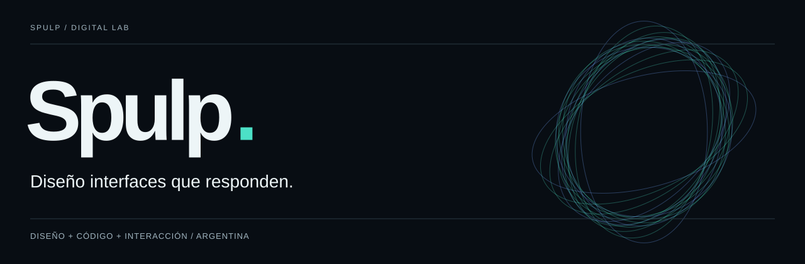
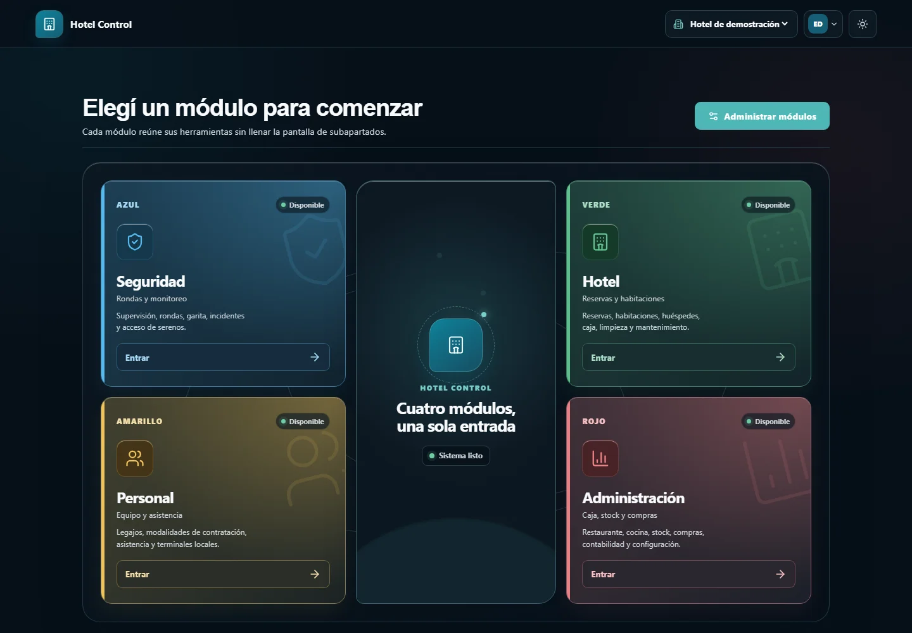

# Skull / SkuuIll

Software developer · Full stack and multiplatform · Argentina

I build web, Android and desktop applications, connecting interfaces, APIs and data. I also work with Linux and automation to prepare the environments where these products run.

**[Explore my portfolio →](https://skuuill.github.io/SkuuIll/)** · [Résumé](https://skuuill.github.io/SkuuIll/cv/) · [Contact](mailto:moreappmix@gmail.com) · [Español](../README.md)

## Selected work

| Project | Purpose | Technologies and links |
| :--- | :--- | :--- |
| **Vigía** | Connect hotel operations, GPS patrols, staff and administration across web and Android. | React · NestJS · PostgreSQL · React Native / Expo · [Case study](https://skuuill.github.io/SkuuIll/proyectos/vigia/) |
| **Apparel commerce and customization** | Product catalog, orders and an Atelier 3D customization experience. | Next.js · TypeScript · Prisma · [Case study](https://skuuill.github.io/SkuuIll/proyectos/cpaul/) |
| **Tactical Map** | Interactive mapping, measurement and planning for the PUBG video game. | JavaScript · Leaflet · PWA · [Application](https://skuuill.github.io/PUBG-Mortar-Tactical-Map/) · [Source](https://github.com/SkuuIll/PUBG-Mortar-Tactical-Map) |
| **Repo Setup Kit** | Reproducible repository setup and tooling for development with agents. | Python · PowerShell · Shell · [Source and installation](https://github.com/SkuuIll/Repo-Setup-Kit) |

## Vigía: four connected areas

- **Security:** patrols, checkpoints, reports, evidence and supervision of received GPS observations during a shift.
- **Staff:** personnel records, attendance, clock-ins, identification and synchronization tools.
- **Hotel:** rooms, reservations, guests, rates, cash operations, housekeeping and maintenance.
- **Administration:** purchasing, inventory, users, permissions and site management, with licensing according to scope.

The ecosystem includes a **web dashboard, API and Android app**, alongside licensing and distribution tools. GPS recording begins with an active shift and consent; history distinguishes received observations and gaps without data.

Source code is private. Screenshots use demonstration data. The module catalog describes project scope; availability is validated by installation, permissions and license.

[Explore the case →](https://skuuill.github.io/SkuuIll/proyectos/vigia/) · [Public distribution](https://github.com/SkuuIll/Vigia-Hotel-Descargas)

## Areas of work

| Area | Tools and applications |
| :--- | :--- |
| **Web and product** | React, Next.js, Astro, TypeScript, HTML and CSS. Commerce, catalogs, dashboards and interfaces. |
| **Android and desktop** | Flutter, Kotlin, React Native / Expo and .NET. Mobile applications and Windows tools. |
| **Backend and data** | Node.js, NestJS, Django and Go. APIs, PostgreSQL, Prisma, SQLite and Redis. |
| **Linux and automation** | VPS, Docker, GitHub Actions, Python, PowerShell and Shell. Environments, integration and development tools. |

## More projects

The [project archive](https://skuuill.github.io/SkuuIll/proyectos/) includes FluxNet, an Android VPN platform under development; a commercial product catalog; a Django editorial platform; the PIPAA / Panza Army website; BattleFX for Windows audio; and automation and video tools.

I also work with open-source software. [NFile-es](https://github.com/SkuuIll/NFile-es) is derived from [Senzme/NFile](https://github.com/Senzme/NFile), with attribution to its original author and GPL v3 licensing. Adaptations and prototypes are identified in their case studies.

## Contact

Tell me about the problem, the platforms involved and what you have already built.

**[moreappmix@gmail.com](mailto:moreappmix@gmail.com)** · [Portfolio](https://skuuill.github.io/SkuuIll/) · [PDF résumé](https://skuuill.github.io/SkuuIll/cv/Facundo-Escobedo-CV.pdf)

GitHub activity

These metrics reflect code hosted on GitHub at their latest generation. They do not represent all professional experience.

<picture>
  <source media="(prefers-color-scheme: dark)" srcset="https://raw.githubusercontent.com/SkuuIll/SkuuIll/output/github-snake-dark.svg">
  
</picture>

About this repository

The GitHub profile and Skull's static portfolio, built with Astro, TypeScript and GSAP. Fonts, images and styles are served locally.

[Development and publishing](../docs/landing.md) · [Profile maintenance](../docs/profile.md) · [Media provenance](../docs/media.md)

